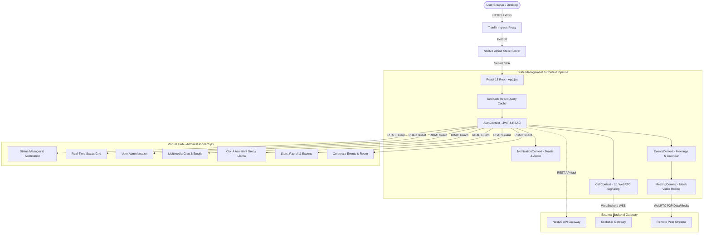
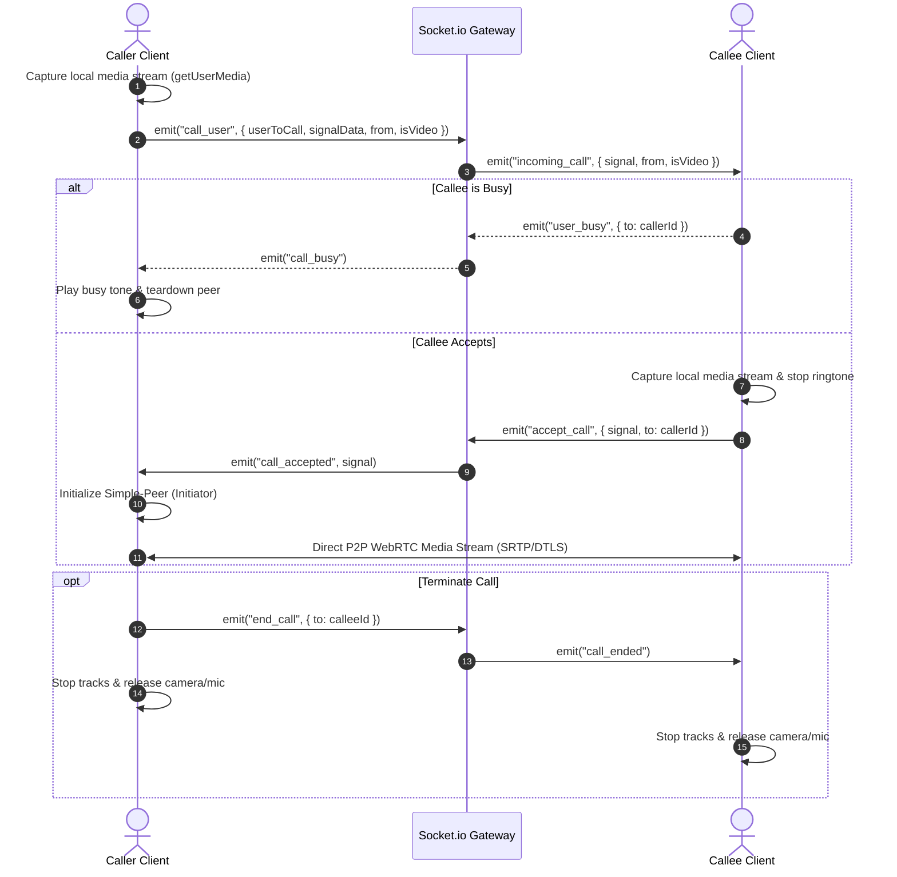
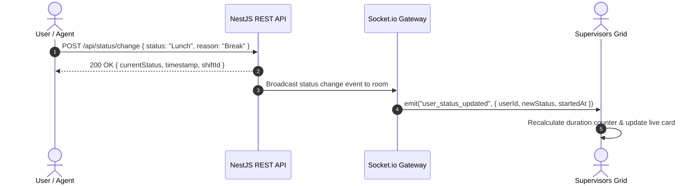
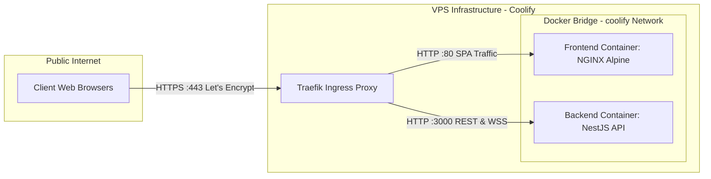

# Clocker Frontend - React & Vite Client

Real-time enterprise collaboration, workforce management, and communication client for the Clocker platform. Built with **React 18**, **Vite 5**, and **Tailwind CSS v4**, featuring real-time WebRTC audio/video mesh calls, instant multimedia messaging, live attendance tracking, dynamic analytics, and an integrated AI assistant (**Clo IA**).

---

## Architecture Overview

The frontend follows a reactive, modular, context-driven architecture. State is segregated across dedicated React Context providers and TanStack React Query caches, communicating bidirectionally with the NestJS backend via HTTP REST endpoints and low-latency Socket.io WebSocket channels.



### Module Responsibilities

| Domain Module | Primary Components | Scope & Responsibility |
| :--- | :--- | :--- |
| **Authentication & RBAC** | `Login.jsx`, `AuthContext.jsx` | JWT lifecycle management, automatic session restoration, 401 unauthorized interception, and granular permission checking via `can()`. |
| **Status & Attendance** | `StatusManager.jsx`, `CurrentStatus.jsx`, `MyAttendance.jsx` | Real-time shift management (Present, Lunch, Break, Meeting, Support), active turn timers, and personal attendance history. |
| **Team Live Monitoring** | `StatusGrid.jsx`, `UserStatusCard.jsx`, `FilterBar.jsx` | Dynamic team-wide dashboard displaying live agent availability, activity durations, and instant status filtering. |
| **Multimedia Chat** | `ChatPanel.jsx`, `ChatMessageItem.jsx`, `MediaMessage.jsx` | 1-to-1 direct messaging, channel chats, emoji picker, multimedia previews (audio/images), and file uploads via Appwrite integration. |
| **1:1 Audio/Video Calls** | `CallManager.jsx`, `IncomingCallModal.jsx`, `CallContext.jsx` | Direct peer-to-peer WebRTC calls via Simple-Peer, screen sharing, audio device toggling, ring tones, and signaling negotiations. |
| **Virtual Meeting Rooms** | `MeetingRoom.jsx`, `LocalVideoTile.jsx`, `RemoteVideoTile.jsx` | Multi-party mesh video conference rooms tied to scheduled corporate calendar events with participant drawers and media controls. |
| **Clo IA Assistant** | `ClockerIA.jsx` | Draggable floating AI chat widget powered by Llama 3.1 through Groq API on backend, featuring Markdown and code formatting. |
| **Corporate Events** | `EventsPanel.jsx`, `EventFormModal.jsx`, `AttendancePromptModal.jsx` | Scheduled team meetings, automated attendance prompt dispatch, RSVP confirmation, and meeting link redirection. |
| **Reports & Analytics** | `ReportsPanel.jsx`, `KPICards.jsx`, `StatusLegend.jsx` | Attendance analytics, shift hour breakdown, Tremor & Recharts visual metrics, and export pipelines (Excel, JSON). |
| **User Administration** | `UserTable.jsx`, `UserForm.jsx`, `EditProfileModal.jsx` | Administrative user CRUD, national identification assignment, role configuration, workgroup tagging, and profile edits. |
| **Notifications** | `NotificationBell.jsx`, `NotificationsPanel.jsx`, `Toast.jsx` | Sound-assisted push notifications, mass corporate broadcast alerts, and system-wide toast messaging. |

---

## Real-Time Signaling & Communication Flows

### 1. WebRTC 1:1 Audio & Video Call Lifecycle

Direct peer-to-peer communication uses Socket.io as an out-of-band signaling mechanism to exchange SDP offers, answers, and ICE candidates without an intermediary media server.



### 2. Live Status & Shift Synchronization Flow

State updates trigger immediate WebSocket dispatches to maintain grid synchronicity across all active supervisors and agents.



---

## Technology Stack

| Layer | Technology | Version | Purpose |
| :--- | :--- | :--- | :--- |
| **Core Framework** | React | 18.3.x | Declarative component UI engine with StrictMode and Concurrent features |
| **Build Tool** | Vite | 5.4.x | Fast dev server, ESM bundling, and Rollup production compilation |
| **Styling & Theme** | Tailwind CSS / PostCSS | 4.3.x | Modern utility-first stylesheet using VGS corporate theme tokens |
| **Realtime Engine** | Socket.io Client | 4.8.x | Bidirectional WebSocket transport for real-time presence, chat, and signaling |
| **Peer-to-Peer Media** | Simple-Peer | 9.11.x | WebRTC mesh abstraction for audio, video, and screen sharing |
| **Server State** | TanStack React Query | 5.101.x | Client-side asynchronous cache, deduping, and query synchronization |
| **Data Visualization** | Tremor / Recharts | 3.18.x | Interactive corporate analytics charts and KPI status distribution bars |
| **Motion & Micro-interactions** | Framer Motion | 12.42.x | Physics-based fluid transitions, modal reveals, and smooth UI shifts |
| **Date & Time Helpers** | Date-fns / React Datepicker | 4.4.x / 9.1.x | Shift duration formatting, timer calculations, and range filtering |
| **Markdown Rendering** | React Markdown / Remark GFM | 10.1.x / 4.0.x | Dynamic rendering of Clo IA assistant responses with syntax support |
| **Icons** | FontAwesome | 7.2.x | Corporate iconography and vector symbols |
| **Node Polyfills** | Vite Node Polyfills | 0.28.x | Buffer and process polyfills required for WebRTC stream wrappers |
| **Static Web Server** | NGINX Alpine Slim | 1.27.x | High-performance, unprivileged containerized HTTP server with gzip |

---

## Project Structure

```text
clocker-react/
├── .dockerignore                   # Docker build context exclusions
├── .env.development                # Development environment variables
├── .env.production                 # Production environment variables
├── Dockerfile                      # Multi-stage production container build (Node 22 -> NGINX 1.27)
├── nginx.conf                      # Production NGINX configuration (SPA routing, Gzip, Caching)
├── package.json                    # Dependencies, scripts, and build configuration
├── postcss.config.js               # PostCSS plugin pipeline for Tailwind CSS v4
├── vite.config.js                  # Vite configuration (manual chunk splitting, polyfills, Terser)
│
├── public/                         # Static assets served untouched
│   ├── images/                     # Logos, browser icons, and default user avatars
│   └── sounds/                     # Incoming call, outgoing call, and notification sound effects
│
└── src/                            # Application source code
    ├── App.css                     # Global custom styles and animations
    ├── App.jsx                     # Top-level context provider nesting and lazy modal mounting
    ├── index.css                   # Tailwind CSS imports and VGS @theme definitions
    ├── main.jsx                    # React 18 DOM entrypoint
    │
    ├── components/                 # Component tree organized by domain
    │   ├── AppContent.jsx          # Root view switcher: Login vs AdminDashboard
    │   │
    │   ├── admin/                  # Supervisor and administration interfaces
    │   │   ├── ChatMessageItem.jsx # Individual chat bubbles with media previews
    │   │   ├── ChatPanel.jsx       # Real-time multimedia chat drawer
    │   │   ├── Dashboard.jsx       # Main navigation tabs, active view switcher, and pagination
    │   │   ├── FilterBar.jsx       # Multi-criteria filtering (Name, ID, Status, Date range)
    │   │   ├── HistoryPanel.jsx    # Historical attendance and status logs
    │   │   ├── NotificationsPanel.jsx # Mass and private alert composer
    │   │   ├── ReportsPanel.jsx    # Analytics dashboard and report export engine
    │   │   ├── StatusGrid.jsx      # Real-time supervisor presence matrix
    │   │   ├── UserForm.jsx        # User creation and modification modal
    │   │   ├── UserStatusCard.jsx  # Individual team member status indicator card
    │   │   └── UserTable.jsx       # Paginated user management table with actions
    │   │
    │   ├── ai/                     # Artificial Intelligence features
    │   │   └── ClockerIA.jsx       # Floating draggable AI assistant connected to Groq
    │   │
    │   ├── auth/                   # Authentication views
    │   │   └── Login.jsx           # National ID login screen with loading animations
    │   │
    │   ├── call/                   # 1:1 WebRTC calling infrastructure
    │   │   ├── CallControlsBar.jsx # Camera, mic, screen share, and hang-up controls
    │   │   ├── CallManager.jsx     # Floating call window with local/remote video streams
    │   │   └── IncomingCallModal.jsx # Incoming call ring dialog (Accept / Decline)
    │   │
    │   ├── common/                 # Reusable atomic design components
    │   │   ├── Badge.jsx           # Status and label tags
    │   │   ├── Button.jsx          # Styled interactive buttons with animations
    │   │   ├── Card.jsx            # Bordered container cards
    │   │   ├── ConfirmationBox.jsx # Interactive action confirmation modals
    │   │   ├── DateRangePicker.jsx # Custom date range selector
    │   │   ├── MediaMessage.jsx    # Chat attachment player/viewer
    │   │   ├── MediaPreviewer.jsx  # Fullscreen image viewer
    │   │   ├── Pagination.jsx      # Tabular pagination controls
    │   │   ├── StatusBadge.jsx     # Color-coded work status badge
    │   │   └── Toast.jsx           # Floating status notifications
    │   │
    │   ├── dashboard/              # Employee self-service attendance
    │   │   ├── CurrentStatus.jsx   # Active status banner with live tick counter
    │   │   ├── MyAttendance.jsx    # Personal shift records and monthly statistics
    │   │   ├── StatusButtons.jsx   # Quick action buttons to change current state
    │   │   ├── StatusManager.jsx   # Shift management container
    │   │   └── UserTimelineModal.jsx # Visual timeline of daily status changes
    │   │
    │   ├── events/                 # Corporate calendar & virtual meetings
    │   │   ├── AttendancePromptModal.jsx # Auto-popup event attendance verification
    │   │   ├── EventDetailModal.jsx# Event metadata, attendees, and meeting launch
    │   │   ├── EventFormModal.jsx  # Event scheduling and participant picker modal
    │   │   ├── EventsPanel.jsx     # Corporate calendar and upcoming event feed
    │   │   ├── MeetingRoom.jsx     # Virtual meeting conference room interface
    │   │   └── meeting/            # Meeting room subcomponents (Tiles, Controls, Drawer)
    │   │
    │   ├── layout/                 # Shell and navigation components
    │   │   ├── Header.jsx          # Top corporate navigation bar and profile popover
    │   │   ├── NotificationBell.jsx# Interactive notification dropdown
    │   │   └── statusConfig.js     # Status metadata (labels, icons, colors, variants)
    │   │
    │   ├── profile/                # Personal user profile
    │   │   └── EditProfileModal.jsx# Profile photo, password, and contact editor
    │   │
    │   └── reports/                # Visual analytics and metric widgets
    │       ├── AnalyticsTooltip.jsx# Custom chart tooltips
    │       ├── KPICards.jsx        # Summary KPI cards (Attendance rate, Total hours)
    │       └── StatusLegend.jsx    # Color legend mapping for status metrics
    │
    ├── contexts/                   # React Context global state providers
    │   ├── AuthContext.jsx         # Session, JWT token, socket instance, and RBAC
    │   ├── CallContext.jsx         # 1:1 WebRTC peer negotiation and stream bindings
    │   ├── EventsContext.jsx       # Event management, attendance prompt dispatch
    │   ├── MeetingContext.jsx      # Multi-peer mesh conference rooms
    │   └── NotificationContext.jsx # Toast and sound notification dispatcher
    │
    ├── hooks/                      # Custom React hooks
    │   └── useDashboard.js         # Tab switching, filtering, debouncing, and pagination
    │
    ├── services/                   # External API clients
    │   └── api.js                  # Axios/Fetch singleton wrapper with 401 interception
    │
    └── utils/                      # Helper functions
        └── formatters.js           # Date, time, currency, and string formatters
```

---

## Environment Configuration

Configuration is managed through environment files resolved by Vite during compilation.

### Key Environment Variables

| Variable | Description | Example |
| :--- | :--- | :--- |
| `VITE_API_URL` | Base endpoint for the NestJS REST API | `https://api.yourdomain.com/api` |
| `VITE_SOCKET_URL` | WebSocket gateway endpoint for Socket.io | `https://api.yourdomain.com` |
| `VITE_BASE_PATH` | Base URL path for SPA deployment (default: `/`) | `/` |
| `VITE_ALLOWED_IPS` | Optional comma-separated IP list for access restriction checks | `*` or `186.115.199.186,186.80.18.114` |

> [!IMPORTANT]
> Because Vite injects `import.meta.env` values statically during the production build step (`npm run build`), changes to environment variables in production require rebuilding the container image or passing build-time arguments.

---

## Local Development

### 1. Prerequisites

* **Node.js**: `>= 20.19.0` (LTS 22.x recommended)
* **npm**: `>= 10.x`
* Running instance of `clocker-backend-nest` (or configured API endpoint)

### 2. Installation

Clone the repository and install all dependencies:

```bash
git clone https://github.com/your-org/clocker-react.git
cd clocker-react
npm install
```

### 3. Local Environment Setup

Create `.env.development` in the root directory:

```env
VITE_API_URL=http://localhost:3000/api
VITE_SOCKET_URL=http://localhost:3000
VITE_BASE_PATH=/
VITE_ALLOWED_IPS=*
```

### 4. Start Development Server

```bash
npm run dev
```

The Vite dev server will start on `http://localhost:5173` with Hot Module Replacement (HMR).

> [!NOTE]
> WebRTC features (`getUserMedia` camera and microphone access) require a secure origin (`https://` or `localhost`). If testing across local network IPs (e.g. `192.168.x.x`), use HTTPS certificates with Vite or test via `localhost`.

---

## Available Scripts

| Script | Command | Purpose |
| :--- | :--- | :--- |
| **Development** | `npm run dev` | Starts the Vite local development server with Fast Refresh. |
| **Production Build** | `npm run build` | Compiles and minifies the SPA into the `dist/` directory using Terser. |
| **Development Build**| `npm run build:dev` | Compiles the build using `.env.development` mode configuration. |
| **Production Mode Build**| `npm run build:prod` | Compiles the build using `.env.production` mode configuration. |
| **Linting** | `npm run lint` | Runs ESLint 9 across all JSX and JavaScript files. |
| **Local Preview** | `npm run preview` | Spins up a local static server to preview the compiled `dist/` output. |

---

## Production Deployment & Coolify Architecture

This application is designed for Zero-Downtime deployments on self-hosted VPS servers managed by **Coolify**, reverse-proxied through **Traefik**, and served via an unprivileged **NGINX Alpine** container.



### 1. Production Dockerfile Specifications

The build uses a high-performance, two-stage Docker pipeline (`Dockerfile`):

```dockerfile
# syntax=docker/dockerfile:1.4
# Stage 1: Build static assets
FROM node:22-slim AS builder
WORKDIR /app

ENV NODE_OPTIONS="--max-old-space-size=2048"

COPY package*.json ./
RUN --mount=type=cache,target=/root/.npm npm ci --no-audit

ARG VITE_API_URL=https://api.yourdomain.com/api
ARG VITE_SOCKET_URL=https://api.yourdomain.com
ARG VITE_BASE_PATH=/

ENV VITE_API_URL=$VITE_API_URL
ENV VITE_SOCKET_URL=$VITE_SOCKET_URL
ENV VITE_BASE_PATH=$VITE_BASE_PATH

COPY . .
RUN npm run build

# Stage 2: Serve with unprivileged NGINX Alpine
FROM nginx:1.27-alpine-slim AS runner

COPY nginx.conf /etc/nginx/conf.d/default.conf
COPY --from=builder /app/dist /usr/share/nginx/html

RUN touch /var/run/nginx.pid && \
    chown -R nginx:nginx /var/run/nginx.pid /usr/share/nginx/html /var/cache/nginx /var/log/nginx /etc/nginx/conf.d

USER nginx
EXPOSE 80

HEALTHCHECK --interval=20s --timeout=4s --start-period=5s --retries=3 \
  CMD wget --quiet --tries=1 --spider http://127.0.0.1:80/healthz || exit 1

CMD ["nginx", "-g", "daemon off;"]
```

### 2. NGINX Hardening & SPA Routing (`nginx.conf`)

* **SPA Fallback Routing**: All non-asset routes fallback to `/index.html`, enabling seamless client-side routing.
* **Cache Strategy**: Static assets with hashes (`.js`, `.css`, fonts, images) are served with `Cache-Control: public, max-age=31536000, immutable`. The `index.html` file is strictly un-cached (`no-cache, no-store, must-revalidate`) to prevent stale deployments.
* **Gzip Compression**: Compresses HTML, CSS, JavaScript, JSON, and SVGs on the fly.
* **Security Headers**: Injects `X-Frame-Options: SAMEORIGIN`, `X-Content-Type-Options: nosniff`, and `X-XSS-Protection`.
* **Healthcheck**: Dedicated `/healthz` endpoint returning `200 healthy` for Docker and Traefik load balancer polling.

### 3. Deploying in Coolify

1. **Create Application in Coolify**:
   * Source: Git Repository (pointing to this repository, `main` branch).
   * Build Pack: **Dockerfile**.
2. **Configure Build Arguments**:
   In the Coolify Application settings, define the Build Arguments (passed to Vite):
   * `VITE_API_URL`: `https://api.yourdomain.com/api`
   * `VITE_SOCKET_URL`: `https://api.yourdomain.com`
   * `VITE_BASE_PATH`: `/`
3. **Traefik Ingress Labels (Custom Labels in Coolify)**:
   ```yaml
   traefik.http.routers.<app-name>.rule=Host(`clocker.yourdomain.com`)
   traefik.http.routers.<app-name>.entrypoints=websecure
   traefik.http.routers.<app-name>.tls=true
   traefik.http.routers.<app-name>.tls.certresolver=letsencrypt
   traefik.http.services.<app-name>.loadbalancer.server.port=80
   traefik.http.services.<app-name>.loadbalancer.healthcheck.path=/healthz
   traefik.http.services.<app-name>.loadbalancer.healthcheck.interval=10s
   ```
4. **Deploy**:
   Trigger deployment via webhook or Coolify dashboard. Coolify will build the Docker image, run healthchecks against `/healthz`, and perform a zero-downtime rolling update via Traefik.

---

## Security Model & Best Practices

* **Secure HTTPS / WSS Enforcement**: All camera, microphone, and WebRTC streaming functionalities require a secure context (`HTTPS`). Traefik automatically issues and renews Let's Encrypt certificates.
* **JWT Lifecycle & Automatic 401 Interception**: Access tokens are stored securely in `localStorage`. If an API call fails with `401 Unauthorized`, a global `"unauthorized-access"` event fires, prompting `AuthContext` to clear credentials, terminate WebSocket rooms, and redirect to login.
* **Client-Side RBAC Enforcement**: Features and tabs are guarded by the `can(permissionName)` function. Administrative panels and destructive operations are concealed if the user's role does not possess the requisite capabilities.
* **Unprivileged Container Execution**: The Docker container runs under the non-root `nginx` user (`UID 101`), preventing container escape vulnerabilities.
* **Corporate Office NAT Protection**: In corporate networks where 30+ users share a single public IP, rate limiting at the Traefik router by IP is avoided to prevent connection timeouts (`ERR_CONNECTION_TIMED_OUT`). Application throttling is handled per-user on the NestJS backend.
* **Memory Leak Prevention**: All Socket.io and WebRTC event listeners in React `useEffect` hooks are explicitly unregistered during unmount cleanup phases.

---

## Troubleshooting & Diagnostics

| Symptom / Issue | Root Cause | Resolution |
| :--- | :--- | :--- |
| **`getUserMedia` error: "Permission denied" or "Not allowed"** | Application is running over insecure HTTP (not localhost or HTTPS). | Serve over HTTPS. WebRTC media device capture is blocked by browsers on plain HTTP. |
| **Stale application version shown after deployment** | Browser cached the previous `index.html`. | Verify `nginx.conf` contains `Cache-Control: "no-store, no-cache"` on `index.html`. Users can perform a hard refresh (`Ctrl + Shift + R`). |
| **WebSocket / Chat fails to connect (`WSS 404 / 502`)** | `VITE_SOCKET_URL` is pointing to the wrong domain or Traefik is missing WebSocket upgrade headers. | Check `VITE_SOCKET_URL` in build args. Traefik supports WebSockets natively, but verify the backend container is healthy. |
| **Build fails with `JavaScript heap out of memory`** | Docker build ran out of RAM on a resource-constrained VPS during minification. | Set `NODE_OPTIONS="--max-old-space-size=2048"` in Dockerfile (already configured) and enable 4GB swap space on the VPS. |
| **WebRTC calls show black screen or no audio** | NAT / Firewall blocking UDP traffic or STUN/TURN server unreachable. | Ensure ICE candidates are exchanged properly and that UDP ports are open on the client network. |

---

## License

This project is proprietary software belonging to **Venture Global Solutions (VGS)**. All rights reserved. Unauthorized reproduction, distribution, or reverse engineering is strictly prohibited.
